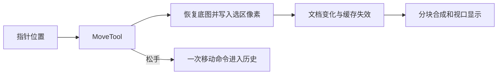

# WebPainter 架构入口

状态: 当前实现的导航及 fork 边界, 2026-11-05 核对。主体源码仍为上游 `a659900384aee878f01e4caae183a666acc7959b`, 4K 方案尚未实现。

## 复用已有结构

原作者的 [ARCHITECTURE](../../docs/ARCHITECTURE.md)、[API](../../docs/API.md)、[PSD_COMPATIBILITY](../../docs/PSD_COMPATIBILITY.md) 保留。这里不复制整套模块说明, 只标明当前工作涉及的 owner。

| Owner | 当前职责 | 性能评估的相关点 |
| --- | --- | --- |
| `src/tools/moveTool.ts` | 选区提取、移动、取消和松手命令 | 当前每个新位置恢复 cutState 并 stampFloat |
| `src/app/editor.ts`, `session.ts` | 活跃文档、工具、UI 通知和历史 | 普通层拖动有交互通知延后, 选区分支未使用同一入口 |
| `src/document`, `src/selection` | 图层与选区模型 | 正式图层关系和选区语义需保持 |
| `src/image-engine/tiledRaster.ts` | 稀疏图块、写时复制、缩略级别 | 图块修改引起边界和缩略缓存重新计算 |
| `src/rendering` | 脏区、合成、显示分块和视口后端 | 已有 live override 和整层 lift, 但不能直接等同选区预览 |
| `src/gpu` | WebGPU 图集、合成和部分效果预览 | override 的 GPU 描述目前只有调整/滤镜 |
| `src/history`, `src/commands` | 可撤销命令 | 保持用户动作到历史步骤的语义 |
| `src/psd`, `src/formats` | 文件读写 | 本轮性能研究不替换文件格式和保存管线 |
| `electron`, `src/app/platform` | 桌面桥与浏览器回退 | 当前已能构建, 完整离线与多后端验收仍需执行 |

## 当前选区移动数据流

记录一次撤销并不能避免拖动过程反复写像素。具体证据归 [4K 评估](../engineering/4K_SELECTION_ASSESSMENT.md)。

## 后续改造边界

- 保留文档、分块存储、历史和 PSD 管线。原型主线已确定为浮动选区状态与稳定资源的 WebGPU 图层内实时合成。
- 接口方向与正确性约束归 [INTERACTIVE_PREVIEW](INTERACTIVE_PREVIEW.md), 实施边界和 gate 归 [任务 02](../ai/tasks/2026-11-05_02_4k-selection-preview-prototype.md); 尚未实施。
- PhotoCraft 作为固定版本源码参考, 不自动引入 Rust、WASM、新状态管理或全新渲染框架。见 [对照](PHOTOCRAFT_REFERENCE.md)。
- 本项目仍是独立 fork。ADA 业务状态、Canvas 节点、Artifact 和 Provider 的 owner 不能因编辑器采用而被复制进来; 集成契约另行设计。
