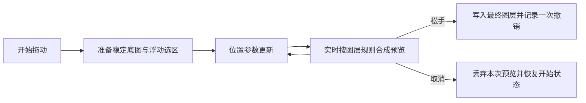

# 交互预览、后台确认与输出交接

状态: 2026-11-06 受限实验原型已实施、复审, 用户实际试用确认性能达到可用水平, 本轮受限 gate 为 Go; 完整场景与正式化仍有未验证项。采用 PhotoCraft 的浮动选区状态思路, 在本项目扩展稳定资源的 WebGPU 图层内实时合成; 松手写回并保留一次拖动一次撤销。决策见 [ADR-0002](../ai/decisions/ADR-0002_floating-selection-webgpu-prototype.md)。

[原型验证任务](../ai/tasks/2026-11-05_02_4k-selection-preview-prototype.md) 定义范围和验收。执行与证据边界以任务记录为准; 支持场景现已按能力默认启用优化路径。用户交互由 [INTERACTION_RULES](../design/INTERACTION_RULES.md) 维护。

## 默认接入

2026-11-06 用户确认正常使用不应有“旧版/优化版”模式开关。已从应用运行链路移除开发实验标记, 支持场景默认使用已有 GPU 浮动预览, 未支持场景由实际能力自动回退; CPU 合成与视口后端兼容仍保留。正常生产、开发和 bat 的编辑语义一致, 不以启动器注入开关实现默认能力。

Move 的显式输出交接、自动保存等待和关闭取消规则由 [默认接入任务](../ai/tasks/2026-11-06_01_default-gpu-selection-move.md) 冻结。默认接入及定向验证已完成, 人工验收待完成; 不扩展优化格式范围或重建渲染器。

## 区分显示与正式数据

用户在拖动中一直看到变化。减少的是正式像素反复修改、缓存重建和中间状态传播, 不是减少必要的视觉反馈。

## 原型主线与配套工作

1. 开始拖动时建立私有的挖空底图和浮动片段, 复用未变图块及必要缩略级别。正式图层和选区像素在松手前不因预览而反复改写。
2. 在现有 GPU 合成接口中描述底图、片段和整数位移, 先在原图层内部组合, 再沿用该层及上方图层的效果。位移是交互参数, 不将整块像素重新上传作为每个输入事件的常规工作。
3. 移动输入按显示节奏采用最新位置; 复用 UI 通知延后及正确失效的块级边界缓存。它们服务于上述主线, 不能单独作为原型成功的替代品。笔刷必要轨迹不受此采样合并影响。
4. 松手时计算正式结果并沿用历史命令; 交接期间保留一致的完整预览。取消只放弃本次交互, 不覆盖后来发生的正式修改。
5. CPU 路径用于结果参考、提交以及未支持场景回退。块/行复制可以辅助准备和提交, 不再与 GPU 预览作为同等未决的主路线。

主线已经确定。受限验证决定的是该实现边界能否满足原型门槛、后续复杂场景的成本, 不再以“先改一点再选择整体路线”为任务目标。原型范围先为 RGB 8 位; 16 位、复杂剪贴/组/效果的完整覆盖另行定义。

## 正确合成的位置

浮动内容和挖空后的底图应先在原图层内部组合, 然后应用该层的 mask、opacity、blend 和相关图层关系。上方调整层仍要看见移动后的内容。

仅在最终画面顶部画一张浮动图片, 对普通不透明单层可能看似正确, 对蒙版、Multiply、剪贴和上方调整层就可能改变结果。不得把这种覆盖方式作为所有场景的实现。

## 当前能力与边界

2026-11-12按main源码更新：

| 能力 | 当前实现 | 边界 |
| --- | --- | --- |
| Move选区 | GPU floating描述在原图层内组合私有cut/pixels | 保留资格回退与原历史语义 |
| Ctrl+T预览 | GPU affine描述可携带projective标记；稳定完整源atlas，逆单应采样 | 简单RGB8层及有限堆栈；复杂组合/mesh warp不在支持范围 |
| 完整画面 | RenderEngine冻结一份准备代际，预算内完成后整份交换；输入更新下一批latest | 持续拖动仍推进；预算是单位间软预算，不保证每单位硬实时 |
| 内容边界 | 按图块revision/格式/默认值缓存局部精确边界，再合并当前图块 | 删除、恢复、COW及写入必须正确失效 |
| 正式确认 | 独立后台Worker计算私有结果，主线程校验并一次历史提交 | 非后台资格的合法场景可标准CPU回退，仍可能阻塞 |

源码入口：[compositor](../../src/rendering/compositor.ts)、[renderEngine](../../src/rendering/renderEngine.ts)、[GPU compositor](../../src/gpu/compositor.ts)、[moveTool](../../src/tools/moveTool.ts)、[transformTool](../../src/tools/transformTool.ts)。

## Ctrl+T预览与正式确认

完整源包含负坐标及画布外像素，不以裁切到文档显示范围的缓存代替。仿射/透视拖动复用源资源并改变采样参数；投影奇异、horizon和容量先检查，GPU资源/功能不足的安全场景才CPU预览回退。透视mip策略与正式CPU区域中心选mip是不同用途，不把显示纹理写为最终图层。

Enter先通过共同几何/总容量预检。支持后台的简单单根RGB/RGBA8普通Normal像素层使用专用Worker，保留原输出原点1024×1024逻辑分区与bicubic语义；256图块仅用于存储/传输。`transformResample.ts`只优化该确认路径的完整邻域访问，通用resample、resize与其他工具不改。峰值操作预算仍768MiB，不以总进程RSS代替预算。

私有源不transfer文档/历史共享buffer；结果分块ACK并组装私有raster。重复Enter不启动第二任务；取消终止专用Worker，保留可调整预览。失败、旧operation/source/session回执不能安装；成功校验后受保护提交一次历史，再等完整权威可见集交接。Worker加载失败仅在共同安全检查通过时允许标准CPU回退；运行中失败不自动同步重做，几何/总容量拒绝不能回退绕过。

操作持有自己的编辑保护token，阻止目标文档外部修改但允许自己的正式历史提交；保存/自动保存等待稳定结果，失败不得保存预览或标记成功。关闭/切文档协调取消与失效，清理只能释放自己的保护。详见[后台确认任务](../ai/tasks/2026-11-11_02_transform-commit-and-projective-preview.md)和[吞吐任务](../ai/tasks/2026-11-12_01_transform-confirm-throughput.md)。

## 状态与生命周期约束

临时交互需绑定 session.id、doc.id、layer.id、源 raster/selection 的对象与版本及本次交互身份。doc.rev 用于结构/属性核对, 不能代替像素版本。资源就绪和显示代次以任务合同为准, 不新增持久文档版本系统。

- 缓存不能成为新的业务真源, 不能向图层列表插入临时业务层来绕过合成。
- Celenne 的 Tile 可原地修改且增加 rev; 不能只按对象身份缓存边界, 需要正确失效。
- 若加入异步预览/提交, 旧文档或已取消交互的结果必须被拒绝。GPU 资源需有结束和释放边界; 允许既有 floating 数据按源身份有界复用, 以保持 A 到 B 到 C 不在 B 留孔洞。
- 当前每次拖动对应一次撤销已经成立; 优化应保留, 不宣称新增此能力。
- 交接期间不能把某些显示块换成新位置, 另一些长期保留旧位置。具体呈现策略需要实测响应与一致性的取舍。
- 历史原型测量使用独立profile与合成文档；当前支持路径已默认接入正常工作流。保存/导出/自动保存读取稳定权威结果并协调进行中的交互，不能沿用原型关闭自动保存的条件作为产品保证。ADA生成消费者另有集成合同。

## 何时再考虑更大改造

原型需给出继续、需修订或证据不足的明确结论。若主线未达到门槛, 根据测量记录原因和超出边界的工作, 不静默切换为另一引擎或扩大任务。只有证据证明瓶颈后, 才另行讨论更大合成器改造、Worker/WASM 或引擎替换。工期范围见 [评估](../engineering/4K_SELECTION_ASSESSMENT.md)。

## 手动输出和关闭的目标保护

Save/Save As/Save Copy/Export 对原目标会话保留输出请求, 快照前完成有效 Move/文字并取得编辑保护。保护在写盘结果和恢复清理完成后释放; 相同会话或相同路径的竞争输出被拒绝, 不建立排队输出。实际工具、操作辅助函数、共享修改命令和异步结果应用检查该目标是否可编辑, 其他会话不受影响。

文件绑定与写入历史保存点独立更新; 保存点仍沿 history entry 判断 clean。关闭等待既有输出并重新检查状态, 保护确认和清理期间的目标, 失败或仍 modified 时保留文档。恢复数据与输出检查点仍按会话串行核对。具体入口、验证证据及人工缺口由 [保存关闭任务](../ai/tasks/2026-11-06_02_save-close-reliability.md) 维护。
