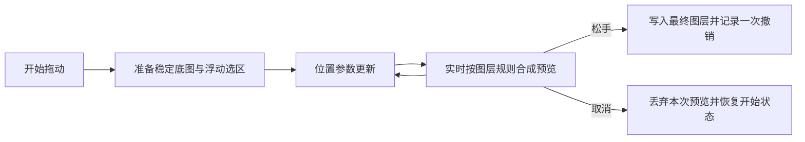

# 选区移动的交互预览主线

状态: 2026-11-06 受限实验原型已实施、复审, 用户实际试用确认性能达到可用水平, 本轮受限 gate 为 Go; 完整场景与正式化仍有未验证项。采用 PhotoCraft 的浮动选区状态思路, 在本项目扩展稳定资源的 WebGPU 图层内实时合成; 松手写回并保留一次拖动一次撤销。决策见 [ADR-0002](../ai/decisions/ADR-0002_floating-selection-webgpu-prototype.md)。

[原型验证任务](../ai/tasks/2026-11-05_02_4k-selection-preview-prototype.md) 定义范围和验收。执行与证据边界以任务记录为准; 支持场景现已按能力默认启用优化路径。用户交互由 [INTERACTION_RULES](../design/INTERACTION_RULES.md) 维护。

## 默认接入

2026-11-06 用户确认正常使用不应有“旧版/优化版”模式开关。已从应用运行链路移除开发实验标记, 支持场景默认使用已有 GPU 浮动预览, 未支持场景由实际能力自动回退; CPU 合成与视口后端兼容仍保留。正常生产、开发和 bat 的编辑语义一致, 不以启动器注入开关实现默认能力。

Move 的显式输出交接、自动保存等待和关闭取消规则由 [默认接入任务](../ai/tasks/2026-11-06_01_default-gpu-selection-move.md) 冻结。默认接入及定向验证已完成, 人工验收待完成; 不扩展优化格式范围或重建渲染器。

## 2026-11-11 片段覆盖与 CPU 回退

[交互对齐任务](../ai/tasks/2026-11-11_01_dialog-and-selection-interaction.md) 在原 Move/LayerOverride/CompositeCommand 链路实现 min Alpha 片段；2026-11-12 按实现审查 F1 将原位剩余纠正为 `max(a-k,0)`，目标放置沿用 source-over，不以原位叠加重建 Alpha 作为挖空条件。Selection.previewOutline 仅作私有显示引用，不进入文档格式或历史。Canvas 轮廓缓存包含 mask 身份；移动中只更新偏移，落定提交像素与选区并保留一次拖动一次撤销。

CPU 回退现在也使用私有 cut 和惰性 LayerOverride.read（保留原生位深），而非在正式 raster 上逐次 restore/stamp。GPU 支持条件没有扩大，GPU 私有 cut/pixels 资源按原能力释放。已有其他 preview 时拒绝开始，不覆盖其他 owner。

局部 guard 同时核对 session/doc/layer/位置、selection/raster/mask 对象及版本、目标模式与 override 身份。失效丢暂态与缓存，清理引用只处理本次对象；提交前复查，提交异常按每个资源最后自有版本分别回滚，外部接管的状态保留。不建立编辑器全局事务系统。真实 WebGPU 小 fixture 和强制 CPU、生产隔离窗口脚本已运行；完整人工/设备及 4K 跟手体验仍 Pending，阶段结果见任务。

## 区分显示与正式数据

用户在拖动中一直看到变化。减少的是正式像素反复修改、缓存重建和中间状态传播, 不是减少必要的视觉反馈。

## 原型主线与配套工作

1. 开始拖动时建立私有的挖空底图和浮动片段, 复用未变图块及必要缩略级别。正式图层和选区像素在松手前不因预览而反复改写。
2. 在现有 GPU 合成接口中描述底图、片段和整数位移, 先在原图层内部组合, 再沿用该层及上方图层的效果。位移是交互参数, 不将整块像素重新上传作为每个输入事件的常规工作。
3. 移动输入按显示节奏采用最新位置; 复用 UI 通知延后及正确失效的块级边界缓存。它们服务于上述主线, 不能单独作为原型成功的替代品。笔刷必要轨迹不受此采样合并影响。
4. 松手时计算正式结果并沿用历史命令; 交接期间保留一致的完整预览。取消只放弃本次交互, 不覆盖后来发生的正式修改。
5. CPU 路径用于结果参考、提交以及未支持场景回退。块/行复制可以辅助准备和提交, 不再与 GPU 预览作为同等未决的主路线。

主线已经确定。受限验证决定的是该实现边界能否满足原型门槛、后续复杂场景的成本, 不再以“先改一点再选择整体路线”为任务目标。原型范围先为 RGB 8 位; 16 位、复杂剪贴/组/效果的完整覆盖另行定义。

## 正确合成的位置

浮动内容和挖空后的底图应先在原图层内部组合, 然后应用该层的 mask、opacity、blend 和相关图层关系。上方调整层仍要看见移动后的内容。

仅在最终画面顶部画一张浮动图片, 对普通不透明单层可能看似正确, 对蒙版、Multiply、剪贴和上方调整层就可能改变结果。不得把这种覆盖方式作为所有场景的实现。

## 现成能力与缺口

| 能力 | 已有基础 | 尚需验证/扩展 |
| --- | --- | --- |
| 内容替换 | `LayerOverride.read`, `RenderEngine.setOverride` | 正确的底图与浮动内容组合、脏区及稳定缓存 |
| GPU 预览 | 当前可描述 adjustment/filter | 目前没有浮动选区位移来源; 仅添加 CPU read 回调仍可能 CPU 计算并上传 |
| 整层缓存拖动 | lift 的 below/moving/above 缓存和交接 | 不能原样套用: beginLift 拒绝 override, 对混合/剪贴/全局调整有限制 |
| 内容边界 | 当前按 raster.version 缓存整体边界 | 评估块级缓存, 需包含块 revision、默认像素和格式语义 |
| 历史 | 现有移动在松手保存一条命令 | 保留现有连续拖动和撤销规则, 不能照搬 PhotoCraft 的跨拖动浮动历史 |

源码入口: [compositor](../../src/rendering/compositor.ts)、[renderEngine](../../src/rendering/renderEngine.ts)、[GPU compositor](../../src/gpu/compositor.ts)、[moveTool](../../src/tools/moveTool.ts)。

## 状态与生命周期约束

临时交互需绑定 session.id、doc.id、layer.id、源 raster/selection 的对象与版本及本次交互身份。doc.rev 用于结构/属性核对, 不能代替像素版本。资源就绪和显示代次以任务合同为准, 不新增持久文档版本系统。

- 缓存不能成为新的业务真源, 不能向图层列表插入临时业务层来绕过合成。
- Celenne 的 Tile 可原地修改且增加 rev; 不能只按对象身份缓存边界, 需要正确失效。
- 若加入异步预览/提交, 旧文档或已取消交互的结果必须被拒绝。GPU 资源需有结束和释放边界; 允许既有 floating 数据按源身份有界复用, 以保持 A 到 B 到 C 不在 B 留孔洞。
- 当前每次拖动对应一次撤销已经成立; 优化应保留, 不宣称新增此能力。
- 交接期间不能把某些显示块换成新位置, 另一些长期保留旧位置。具体呈现策略需要实测响应与一致性的取舍。
- 原型只在独立 profile 的合成文档运行并关闭自动保存, 不默认替换日常工作流。正式化前必须定义拖动与保存/导出/自动保存读取的一致性; 未来生成消费者另行接入。本轮未设计新保存格式或 ADA 协议。

## 何时再考虑更大改造

原型需给出继续、需修订或证据不足的明确结论。若主线未达到门槛, 根据测量记录原因和超出边界的工作, 不静默切换为另一引擎或扩大任务。只有证据证明瓶颈后, 才另行讨论更大合成器改造、Worker/WASM 或引擎替换。工期范围见 [评估](../engineering/4K_SELECTION_ASSESSMENT.md)。

## 手动输出和关闭的目标保护

Save/Save As/Save Copy/Export 对原目标会话保留输出请求, 快照前完成有效 Move/文字并取得编辑保护。保护在写盘结果和恢复清理完成后释放; 相同会话或相同路径的竞争输出被拒绝, 不建立排队输出。实际工具、操作辅助函数、共享修改命令和异步结果应用检查该目标是否可编辑, 其他会话不受影响。

文件绑定与写入历史保存点独立更新; 保存点仍沿 history entry 判断 clean。关闭等待既有输出并重新检查状态, 保护确认和清理期间的目标, 失败或仍 modified 时保留文档。恢复数据与输出检查点仍按会话串行核对。具体入口、验证证据及人工缺口由 [保存关闭任务](../ai/tasks/2026-11-06_02_save-close-reliability.md) 维护。
